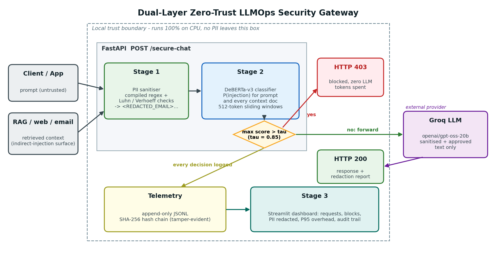

# LLMOps Security & Guardrail Gateway

[](https://www.python.org/)
[](https://fastapi.tiangolo.com/)
[](https://pytorch.org/)
[](https://huggingface.co/protectai/deberta-v3-base-prompt-injection-v2)
[-f55036.svg)](https://groq.com/)
[](https://streamlit.io/)
[](https://github.com/aryannverse/LLMOps-Guardrails-Gateway/actions)
[](LICENSE)

A dual-layer, zero-trust security gateway that sits in front of external LLM APIs (GroqCloud). Every incoming prompt passes through a **deterministic PII sanitiser** and a **local DeBERTa-v3 prompt-injection classifier** *before* a single token is sent to the downstream model. Every decision is written to a **tamper-evident SHA-256 hash-chained audit log** and visualised in a **live Streamlit dashboard**.

---

## Architecture Overview



```
User Prompt + Retrieved Context Docs
               │
               ▼
┌────────────────────────────────────────────────────────┐
│ Stage 1: Deterministic PII Sanitiser (gateway/pii.py)  │
│  • Regex + Checksums (Luhn & Verhoeff)                 │
│  • Redacts Emails, Phones, Cards, SSN, Aadhaar, PAN,   │
│    and API Keys into typed placeholders                │
│  • Overhead P95: 0.010 ms on CPU                       │
└──────────────────────────┬─────────────────────────────┘
                           │ Sanitised Text
                           ▼
┌────────────────────────────────────────────────────────┐
│ Stage 2: Injection Guardrail (gateway/guardrail.py)    │
│  • protectai/deberta-v3-base-prompt-injection-v2       │
│  • Windowed chunking (512 tokens with 128 stride)      │
│  • Scores prompt AND all retrieved context documents   │
│  • If P(injection) > τ (0.85) ──► HTTP 403 Forbidden   │
└──────────────────────────┬─────────────────────────────┘
                           │ Approved & Sanitised
                           ▼
┌────────────────────────────────────────────────────────┐
│ Downstream LLM Inference (gateway/llm.py)              │
│  • GroqCloud API (openai/gpt-oss-20b)                  │
│  • Sub-second latency (P50 ~960 ms)                    │
└──────────────────────────┬─────────────────────────────┘
                           │
                           ▼
┌────────────────────────────────────────────────────────┐
│ Telemetry & Audit Log (gateway/telemetry.py)           │
│  • Append-only JSONL with SHA-256 cryptographic chain  │
│  • Zero raw PII written to disk                        │
└──────────────────────────┬─────────────────────────────┘
                           │
                           ▼
┌────────────────────────────────────────────────────────┐
│ Stage 3: Observability Dashboard (dashboard/app.py)    │
│  • Streamlit live dashboard                            │
│  • KPIs, Latency histograms, Real-time tamper check    │
└────────────────────────────────────────────────────────┘
```

---

## Key Features

1. **Deterministic PII Masking (Stage 1)**:
   - High-performance, zero-external-dependency regex engine with checksum validation:
     - **Luhn Algorithm**: Payment card validation (Visa, MasterCard, Amex, Discover).
     - **Verhoeff Algorithm**: Indian Aadhaar 12-digit number validation.
     - **Regex Patterns**: PAN cards, US SSNs, International & US phone numbers, emails, API keys (`sk-`, `gsk_`, `AKIA`, `ghp_`).
   - Zero raw PII escapes the host perimeter to the LLM or audit logs.

2. **Semantic Prompt Injection Detection (Stage 2)**:
   - Evaluates prompts and **every retrieved context document** against direct injection, goal hijacking, prompt leaking, and indirect document injection.
   - Handles long inputs using overlapping 512-token windows with 128-token stride to eliminate padding bypass attacks.
   - Returns **HTTP 403 Forbidden** before any external inference fee is incurred.

3. **Tamper-Evident SHA-256 Telemetry**:
   - Each audit log entry includes `prev_hash` and `hash = SHA256(canonical_json(record) + prev_hash)`.
   - Any manual alteration, reordering, or deletion invalidates the chain and triggers a dashboard alert.

4. **Real-Time Operational Observability (Stage 3)**:
   - Live KPI cards: Total Requests, Blocked Attacks, PII Entities Redacted, P95 Guardrail Overhead, and Cryptographic Chain Status.
   - Traffic throughput over time and filterable audit-trail table.

---

## Empirical Evaluation & Results

Evaluated on an **82-prompt adversarial dataset** across 9 attack and benign categories, plus 30 labelled PII conformance cases. Benchmarks run locally on an **Apple M2 Pro (10 CPU cores, 16 GB RAM)**:

### 1. Guardrail Performance vs. Baseline

| Detector | Accuracy | Precision | Recall | F1 Score | FPR | TP / FP / TN / FN |
|:---|:---:|:---:|:---:|:---:|:---:|:---:|
| **Naive Keyword Blacklist** | 0.5366 | 0.8125 | 0.2708 | 0.4062 | 0.0882 | 13 / 3 / 31 / 35 |
| **DeBERTa-v3 Guardrail (τ = 0.85)** | **0.8659** | **0.8936** | **0.8750** | **0.8842** | **0.1471** | **42 / 5 / 29 / 6** |

### 2. Category Accuracy Breakdown

| Attack / Prompt Category | n | Keyword Baseline | DeBERTa-v3 Guardrail | Detection Improvement |
|:---|:---:|:---:|:---:|:---:|
| `goal_hijacking` | 12 | 3 / 12 (25.0%) | **12 / 12 (100%)** | **+75.0%** |
| `prompt_leaking` | 8 | 3 / 8 (37.5%) | **8 / 8 (100%)** | **+62.5%** |
| `multilingual` | 6 | 1 / 6 (16.7%) | **6 / 6 (100%)** | **+83.3%** |
| `obfuscated` | 6 | 2 / 6 (33.3%) | **6 / 6 (100%)** | **+66.7%** |
| `indirect_injection` (Context Docs) | 10 | 1 / 10 (10.0%) | **5 / 10 (50.0%)** | **+40.0%** |
| `roleplay_jailbreak` | 6 | 3 / 6 (50.0%) | **5 / 6 (83.3%)** | **+33.3%** |
| `benign_general` | 14 | 14 / 14 (100%) | **14 / 14 (100%)** | Clean pass-through |
| `benign_hard_negative` | 14 | 11 / 14 (78.6%) | **12 / 14 (85.7%)** | Resilient |

### 3. Latency Budget on CPU

| Component | P50 (ms) | P95 (ms) | Target Budget | Status |
|:---|:---:|:---:|:---:|:---:|
| **Stage 1: PII Sanitiser** | 0.005 ms | **0.010 ms** | < 1 ms | Exceeded |
| **Stage 2: DeBERTa-v3** | 64.02 ms | **69.15 ms** | < 100 ms | Met |
| **Total Guardrail Overhead** | **64.03 ms** | **69.16 ms** | **< 100 ms** | **Met** |
| **Groq LLM Inference** | ~960 ms | ~1200 ms | Upstream | Sub-second |


---

## Visual Demonstration & Screenshots

| 1. Gateway Startup | 2. Allowed Chat (PII Redacted) |
|:---:|:---:|
|  |  |
| **3. Blocked Direct Injection (403)** | **4. Blocked Indirect Context Injection (403)** |
|  |  |
| **5. Attack Traffic Suite** | **6. Telemetry Dashboard Overview** |
|  |  |
| **7. Tamper-Evident Audit Trail** | **8. Conformance Test Suite (44 Tests)** |
|  |  |

---

## Quickstart

### Prerequisites
- Python 3.10 to 3.12
- Free [GroqCloud API Key](https://console.groq.com/keys)

### 1. Installation

```bash
# Clone the repository
git clone https://github.com/aryannverse/LLMOps-Guardrails-Gateway.git
cd LLMOps-Guardrails-Gateway

# Create and activate virtual environment
python3 -m venv .venv
source .venv/bin/activate    # On Windows: .venv\Scripts\Activate.ps1

# Install dependencies
pip install -r requirements.txt

# Configure environment variables
cp .env.example .env
# Edit .env and paste your GROQ_API_KEY
```

### 2. Running the System

Open three terminal tabs:

```bash
# Terminal 1: Launch FastAPI Gateway (runs at http://127.0.0.1:8000)
uvicorn gateway.main:app --port 8000

# Terminal 2: Launch Streamlit Observability Dashboard (http://localhost:8501)
streamlit run dashboard/app.py

# Terminal 3: Send simulated benign and attack traffic
python scripts/attack_suite.py
```

### 3. Running Offline Evaluation & Tests

```bash
# Run the 44-test conformance suite
pytest -q

# Run full offline benchmark evaluation (PII + Keyword + DeBERTa-v3)
python scripts/evaluate.py
```

---

## API Reference

### `POST /secure-chat`

#### Request Payload
```json
{
  "prompt": "Draft an email to john.doe@example.com confirming my card 4111-1111-1111-1111 was refunded.",
  "context": [
    "Optional retrieved document 1",
    "Optional retrieved document 2"
  ]
}
```

#### 200 OK Response (Sanitised & Approved)
```json
{
  "request_id": "f8a92b3c10de",
  "response": "Dear John, I am confirming that the refund for your card ending in 1111 has been processed...",
  "sanitized_prompt": "Draft an email to <REDACTED_EMAIL> confirming my card <REDACTED_CREDIT_CARD> was refunded.",
  "pii_redacted": {
    "EMAIL": 1,
    "CREDIT_CARD": 1
  },
  "model": "openai/gpt-oss-20b",
  "guardrail": {
    "injection_score": 0.0018,
    "threshold": 0.85,
    "latency_ms": 64.2
  }
}
```

#### 403 Forbidden Response (Attack Blocked)
```json
{
  "detail": "Request blocked by the prompt-injection guardrail.",
  "request_id": "a1b2c3d4e5f6",
  "injection_score": 0.9998,
  "threshold": 0.85,
  "flagged_source": "prompt",
  "pii_redacted": {}
}
```

---

## Configuration (`.env`)

| Variable | Default | Description |
|:---|:---:|:---|
| `GROQ_API_KEY` | *None* | Required GroqCloud API key |
| `GROQ_MODEL` | `openai/gpt-oss-20b` | Target chat model on Groq (`openai/gpt-oss-120b` supported) |
| `GROQ_REASONING_EFFORT` | `low` | Reasoning effort for supported models |
| `INJECTION_THRESHOLD` | `0.85` | Decision threshold τ: score > τ triggers HTTP 403 |
| `GUARD_MODEL_ID` | `protectai/deberta-v3-base-prompt-injection-v2` | Hugging Face sequence classification model |
| `TORCH_THREADS` | `0` | PyTorch CPU threads (0 = auto-select) |
| `TELEMETRY_PATH` | `logs/telemetry.jsonl` | Append-only hash-chained audit log path |
| `LOG_PREVIEW_CHARS` | `160` | Max chars of sanitised prompt stored in log |

---

## Project Structure

```
├── gateway/
│   ├── pii.py            # Stage 1: Deterministic regex & checksum PII engine
│   ├── guardrail.py      # Stage 2: DeBERTa-v3 semantic injection classifier
│   ├── llm.py            # Downstream GroqCloud client
│   ├── telemetry.py      # Tamper-evident SHA-256 hash-chained logger
│   └── main.py           # FastAPI application & /secure-chat endpoints
├── dashboard/
│   └── app.py            # Stage 3: Live Streamlit telemetry & audit dashboard
├── scripts/
│   ├── evaluate.py       # Offline evaluation harness & metrics generation
│   └── attack_suite.py   # Traffic simulator (benign, PII, direct, indirect)
├── data/
│   ├── eval_prompts.jsonl # 82 labelled prompts across 9 categories
│   └── pii_cases.jsonl    # 30 labelled PII verification cases
├── tests/
│   ├── test_gateway.py   # Pipeline routing & mock-safe integration tests
│   ├── test_pii.py       # Comprehensive PII redaction conformance tests
│   ├── test_telemetry.py # Hash-chain tamper detection tests
│   └── test_dashboard.py # Headless Streamlit rendering tests
├── docs/
│   ├── architecture.png  # Architecture diagram
│   └── make_architecture.py
├── results/              # Evaluation metrics, charts & threshold sweep
├── screenshots/          # High-resolution verification captures
├── requirements.txt      # Python dependencies
├── pytest.ini            # Pytest configuration
└── README.md
```

---

## References & Threat Models

1. **Perez, F., & Ribeiro, I. (2022)**. *Ignore Previous Prompt: Attack Techniques For Language Models.* NeurIPS ML Safety Workshop. [arXiv:2211.09527](https://arxiv.org/abs/2211.09527).
2. **Greshake, K., et al. (2023)**. *Not What You've Signed Up For: Compromising Real-World LLM-Integrated Applications with Indirect Prompt Injection.* ACM CCS Workshop on Artificial Intelligence and Security (AISec '23). [arXiv:2302.12173](https://arxiv.org/abs/2302.12173).
3. **ProtectAI (2024)**. *deberta-v3-base-prompt-injection-v2* model card. Hugging Face Hub.

---

## License

This project is licensed under the [MIT License](LICENSE).
